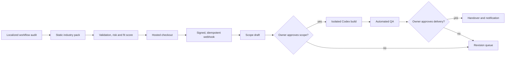

# Morning Operator / 早安店長

[](https://github.com/mars-tw/morning-operator/actions/workflows/ci.yml)
[](https://github.com/mars-tw/morning-operator/actions/workflows/codeql.yml)
[](LICENSE)

**A multilingual, approval-gated automation service factory for repeatable business operations.**

English · [繁體中文](README.zh-TW.md) · [日本語](docs/README.ja.md) · [Español](docs/README.es.md)

**Free interactive preview:** [Open the four-project showcase and SEO growth lab](https://mars-tw.github.io/morning-operator/) · [Read the SEO service specification](docs/seo-service.md)

Morning Operator turns a public workflow audit into a controlled service-delivery pipeline: industry-pack selection, fit scoring, signed payment events, scope approval, isolated AI-assisted build, QA, delivery approval, notification, audit log, and backup. It is open source under Apache-2.0, provider-neutral, and designed to be self-hosted.

> The default configuration is a demo. It does not collect real payments, send real email, connect to external platforms, or deploy generated work. Revenue, payback, and time-saved figures are estimates, never guarantees. No industry pack guarantees that a business or user will make money.

## Why this exists

Small teams across many industries repeat the same reporting, lead follow-up, scheduling, content, document, and exception-handling work. This project provides the safe workflow around automating a reviewed portion of that work—not a promise of autonomous income or a replacement for professional judgment.

- Public locales: English, Traditional Chinese, Japanese, and Spanish.
- Shareable locale URLs: `/en`, `/zh-TW`, `/ja`, and `/es`.
- Human approval before AI build and before production delivery.
- Six versioned industry packs: commerce operations, professional services, appointments, creator/education, property/field services, and back-office operations.
- A multilingual website launch planner for portable sales, campaign, catalog, and booking sites with free-first Cloudflare, Firebase, GCP, and source-only routes.
- A dependency-free, four-locale open-source preview gallery for web design, appointments, creator products, and group-buy operations, plus a no-data SEO growth lab.
- A fixed-scope SEO foundation recipe for one approved origin, one locale, up to 20 URLs, three priority pages, and a reviewable 90-day measurement loop.
- Provider-neutral adapters for payments, email, monitoring, business platforms, and AI execution.
- SQLite job queue with leases, retry backoff, dead-letter state, and audit records.
- Docker self-hosting with separate web and worker services.
- Restricted scopes and consequential decisions are rejected or routed to human review.
- No unnecessary customer, client, patient, learner, tenant, or employee personal data is sent to AI.

Each pack is a static, reviewable template with supported goals, an estimated automation-coverage range, metrics, approval requirements, and prohibited actions. See [Industry packs](docs/industry-packs.md) before adding or changing a pack.

## Quick start

Requirements: Node.js 24+, pnpm 11+, and Git.

```powershell
git clone https://github.com/mars-tw/morning-operator.git
Set-Location morning-operator
pnpm install
Copy-Item .env.example .env.local
pnpm seed
pnpm dev
```

Open `http://localhost:3000`. The root route selects a supported language from `Accept-Language`; use `/en`, `/zh-TW`, `/ja`, or `/es` to select one directly.

Start the background worker in another terminal:

```powershell
pnpm worker
```

The demo owner console is at `http://localhost:3000/admin/login`. Production startup rejects the example password and weak session secrets.

## Self-host with containers

Read [Self-hosting](docs/self-hosting.md) before starting. The short path is:

```bash
cp .env.example .env
docker compose build
docker compose up -d web worker
```

The Compose setup uses a persistent SQLite volume, non-root containers, read-only root filesystems, health checks, and a maintenance backup profile. SQLite is supported for one application host and one worker; use a future PostgreSQL adapter before horizontal multi-host scaling.

## Workflow

Learners can start with the multilingual project setup optimizer, select one of six reviewed recipes, and preview assignment execution, commercial delivery, market, and monetization readiness without storing customer data. See [project recipes and readiness](docs/project-recipes.md). Scores and revenue scenarios are estimates, never guarantees.



The full architecture is in [docs/architecture.md](docs/architecture.md), pack contract in [docs/industry-packs.md](docs/industry-packs.md), approval boundaries in [docs/approval-matrix.md](docs/approval-matrix.md), and the AI organization tree in [docs/organization-tree.md](docs/organization-tree.md).

Payment integration is documented in [payment webhooks](docs/payment-webhooks.md) and the [Taiwan/open-source payment guide](docs/taiwan-payments.md). ECPay AIO checkout and signed callbacks are implemented; NewebPay, TapPay, and LINE Pay are explicitly documented-only until merchant credentials and server-side reconciliation tests exist.

Generated sales and promotional websites use the [free-first deployment guide](docs/deployment.md). Cloudflare Pages is the static commercial default, Workers is the dynamic default, and GitHub is used for source and CI rather than GitHub Pages commercial hosting. Production publication still requires a recorded deployment approval.

## Configuration

Copy `.env.example` and set only the adapters you intend to use. Important groups include:

- Runtime and locale defaults.
- Public offer currency and minor-unit prices.
- Strong owner password and session secret.
- Hosted checkout and signed webhook secret.
- Verified email sender and monitoring DSN.
- Approved Codex execution mode and timeout.
- Optional, least-privilege platform adapters selected for an approved industry pack.

Never commit `.env`, database files, customer data, API credentials, generated workspaces, or payment payloads. See [Production readiness](docs/production-readiness.md) and [external activation](docs/external-activation.md).

## Verification

```powershell
pnpm verify
pnpm test:e2e
```

`pnpm verify` runs the secret scan, static showcase verifier, typecheck, unit tests, production build, end-to-end workflow smoke test, and backup restore integrity check. Container builds are also required by CI because the current Windows development host may not have a Docker engine.

## Project status

The repository contains a complete demonstrable vertical slice, six static industry packs, and production safety gates. It does **not** include a hosted public service, merchant KYC, tax registration, a verified sending domain, or credentials for external business platforms. Those external actions belong to each deployer.

## Contributing and support

- [Contributing](CONTRIBUTING.md)
- [Code of Conduct](CODE_OF_CONDUCT.md)
- [Security policy](SECURITY.md)
- [Support policy](SUPPORT.md)
- [Governance](GOVERNANCE.md)
- [Release process](docs/releasing.md)
- [Changelog](CHANGELOG.md)

Please report vulnerabilities privately. Never place credentials or real customer data in an issue, pull request, log, or screenshot.

## License

Apache License 2.0. See [LICENSE](LICENSE).
