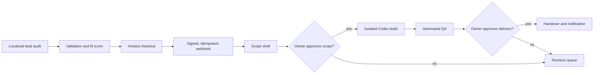

# Morning Operator / 早安店長

**A multilingual, approval-gated operations workflow for small Shopify teams.**

English · [繁體中文](README.zh-TW.md) · [日本語](docs/README.ja.md) · [Español](docs/README.es.md)

Morning Operator turns a public lead audit into a controlled service-delivery workflow: intake, fit scoring, signed payment events, scope approval, isolated AI-assisted build, QA, delivery approval, notification, audit log, and backup. It is open source under Apache-2.0 and designed to be self-hosted.

> The default configuration is a demo. It does not collect real payments, send real email, connect to Shopify, or deploy generated work. Revenue and time-saved figures are estimates, never guarantees.

## Why this exists

Small commerce teams often copy sales, refunds, fulfillment delays, and inventory warnings into spreadsheets every morning. This project provides the safe workflow around automating that service—not a promise of autonomous income.

- Public locales: English, Traditional Chinese, Japanese, and Spanish.
- Shareable locale URLs: `/en`, `/zh-TW`, `/ja`, and `/es`.
- Human approval before AI build and before production delivery.
- Provider adapters for payments, email, monitoring, Shopify, and AI execution.
- SQLite job queue with leases, retry backoff, dead-letter state, and audit records.
- Docker self-hosting with separate web and worker services.
- No raw Shopify customer personal data is sent to AI.

## Quick start

Requirements: Node.js 24+, pnpm 11+, and Git.

```powershell
pnpm install
Copy-Item .env.example .env.local
pnpm seed
pnpm dev
```

Open `http://localhost:3000`. The root route selects a supported language from `Accept-Language`; use `/en`, `/zh-TW`, `/ja`, or `/es` to select one directly.

Start the background worker in another terminal:

```powershell
pnpm worker
```

The demo owner console is at `http://localhost:3000/admin/login`. Production startup rejects the example password and weak session secrets.

## Self-host with containers

Read [Self-hosting](docs/self-hosting.md) before starting. The short path is:

```bash
cp .env.example .env
docker compose build
docker compose up -d web worker
```

The Compose setup uses a persistent SQLite volume, non-root containers, read-only root filesystems, health checks, and a maintenance backup profile. SQLite is supported for one application host and one worker; use a future PostgreSQL adapter before horizontal multi-host scaling.

## Workflow



The full architecture is in [docs/architecture.md](docs/architecture.md), approval boundaries in [docs/approval-matrix.md](docs/approval-matrix.md), and the AI organization tree in [docs/organization-tree.md](docs/organization-tree.md).

## Configuration

Copy `.env.example` and set only the adapters you intend to use. Important groups include:

- Runtime and locale defaults.
- Public offer currency and minor-unit prices.
- Strong owner password and session secret.
- Hosted checkout and signed webhook secret.
- Verified email sender and monitoring DSN.
- Approved Codex execution mode and timeout.

Never commit `.env`, database files, customer data, API credentials, generated workspaces, or payment payloads. See [Production readiness](docs/production-readiness.md) and [external activation](docs/external-activation.md).

## Verification

```powershell
pnpm verify
pnpm test:e2e
```

`pnpm verify` runs the secret scan, typecheck, unit tests, production build, end-to-end workflow smoke test, and backup restore integrity check. Container builds are also required by CI because the current Windows development host may not have a Docker engine.

## Project status

The repository contains a complete demonstrable vertical slice and production safety gates. It does **not** include a hosted public service, merchant KYC, tax registration, a verified sending domain, or real Shopify credentials. Those external actions belong to each deployer.

## Contributing and support

- [Contributing](CONTRIBUTING.md)
- [Code of Conduct](CODE_OF_CONDUCT.md)
- [Security policy](SECURITY.md)
- [Support policy](SUPPORT.md)
- [Governance](GOVERNANCE.md)
- [Release process](docs/releasing.md)
- [Changelog](CHANGELOG.md)

Please report vulnerabilities privately. Never place credentials or real customer data in an issue, pull request, log, or screenshot.

## License

Apache License 2.0. See [LICENSE](LICENSE).
