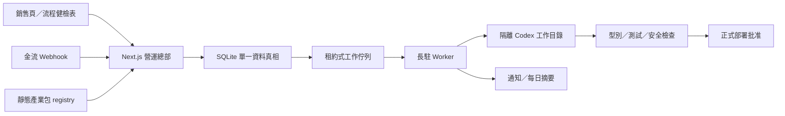
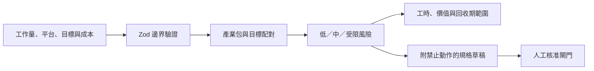

# 系統架構



SQLite 啟用 WAL、foreign keys 與 busy timeout。付款事件、專案與工作在同一交易內建立；工作採租約、最大嘗試次數、指數退避與 dead-letter。公開部署若需要多台 worker，先把 repository 層遷移至 PostgreSQL。

## 多產業接入

系統不將公開表單的「產業」視為可執行指令。邊界驗證只接受內建 registry 中的產業包 ID 與支援目標，再將結構化輸入作為不可信任資料寫入 SQLite。產業包提供的是靜態、版本化且可審閱的工作流程合約；詳見 [產業包文件](industry-packs.md)。

網站開發需求同樣經過靜態 registry：`site_type` 決定靜態或動態 runtime，`deployment_target` 只接受已知供應商 ID，商業站不可選 GitHub Pages，動態站不可選純靜態主機。資料庫只保存選擇，不保存主機憑證；建置規格批准後才交給隔離 workspace，正式發佈仍需 deployment approval。詳見 [免費優先發佈](deployment.md)。



估算是協助篩選的上下界，不是獲利保證。受限的範圍不建立自動交付工作；必須轉人工審查或縮小成安全的讀取／草擬作業。任何對外平台串接皆為選配 adapter，不影響無憑證 mock 路徑的完整性。

## 金流 adapter

所有正式金流先建立本機付款嘗試，再透過 hosted checkout 或 tokenized SDK 交給 PSP；付款只有在背景驗簽或伺服器反查，且商戶訂單、lead、固定報價與幣別完全一致後才成立。綠界 AIO 已具備結帳與回呼 adapter；其他台灣 provider 的完成條件見 [台灣與開源金流接入](taiwan-payments.md)。開源支付編排器是可選的基礎設施，不能替代 PSP 合約或 KYC。

## 專案狀態

```text
paid → spec_draft → spec_approval → build_queued → building
     → qa_failed | qa_passed → deploy_approval → delivered
```

## 設計方向

介面採「店長交班簿」而非一般 SaaS 儀表板：霧藍紙張、深藍墨水、朱紅核准章與青綠運行狀態。標題使用宋體系，正文使用台灣常見無襯線字體，數字與狀態使用等寬字體。首頁的辨識元素是可檢視的產業包藍圖與作業傳送帶；動態僅用於呈現事件流，並尊重 reduced-motion。
