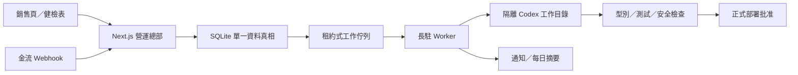

# 系統架構



SQLite 啟用 WAL、foreign keys 與 busy timeout。付款事件、專案與工作在同一交易內建立；工作採租約、最大嘗試次數、指數退避與 dead-letter。公開部署若需要多台 worker，先把 repository 層遷移至 PostgreSQL。

## 專案狀態

```text
paid → spec_draft → spec_approval → build_queued → building
     → qa_failed | qa_passed → deploy_approval → delivered
```

## 設計方向

介面採「店長交班簿」而非一般 SaaS 儀表板：霧藍紙張、深藍墨水、朱紅核准章與青綠運行狀態。標題使用宋體系，正文使用台灣常見無襯線字體，數字與狀態使用等寬字體。首頁的辨識元素是從訂單流向晨報的作業傳送帶；動態僅用於呈現事件流，並尊重 reduced-motion。

