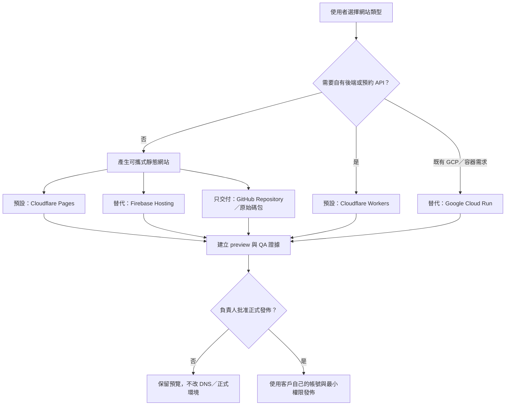

# 免費優先的銷售／宣傳網站發佈

本文件處理 Morning Operator 為客戶產生的獨立銷售頁、活動頁、商品／服務型錄與預約網站。它不代表本專案主程式適合直接搬到任何靜態主機；Morning Operator 本身仍包含 SQLite、背景 worker、付款 Webhook 與管理後台，完整自架方式請看 [`self-hosting.md`](self-hosting.md)。

免費額度查核日：**2026-07-17**。供應商可以隨時調整方案；上線前必須再檢查官方價格、流量、商業使用、資料區域與帳務設定。免費主機不包含付費網域、Email、第三方表單、資料庫、金流手續費或超額流量。

## 預設選擇

| 網站需求 | 預設路線 | 為什麼 | 註冊／帳務 |
|---|---|---|---|
| 銷售落地頁、活動頁、型錄，付款導向受信任的託管結帳 | **Cloudflare Pages** | 靜態檔案、全球 CDN、自訂網域與 Git 串接；免費方案目前每月 500 次建置、每帳號 100 個 Pages 專案 | 簡單；免費方案可先不綁帳務 |
| 預約 API、受控表單、伺服器端驗證 | **Cloudflare Workers** | 動態邏輯靠近使用者；免費方案目前每日 100,000 次請求 | 簡單；必須監控每日額度 |
| 使用者已有 Google 帳號且只需要靜態站 | **Firebase Hosting** | Spark 方案不需要付款方式；目前含 10 GB 儲存與每日 360 MB 傳輸 | 簡單；超過 Spark 功能時才評估 Blaze |
| 容器、較完整後端或既有 GCP 環境 | **Google Cloud Run** | Request-based 免費層目前含每月 200 萬次請求及 CPU／RAM 額度 | 較複雜；需要帳務帳號與預算告警，建置、映像與網路可能另計 |
| 只交付原始碼 | **Source bundle + GitHub Repository** | 零主機權限；客戶持有可移轉的原始碼與版本紀錄 | GitHub 免費 Repository 可用，正式發佈另選主機 |
| GitHub Pages | **商業銷售站禁止選用** | GitHub 官方明確表示 Pages 不得作為線上商業、電商或 SaaS 的免費主機 | 只可用於合規的專案文件或非商業展示 |

官方依據：[Cloudflare Pages limits](https://developers.cloudflare.com/pages/platform/limits/)、[Cloudflare Workers limits](https://developers.cloudflare.com/workers/platform/limits/)、[Firebase pricing](https://firebase.google.com/pricing)、[Cloud Run pricing](https://cloud.google.com/run/pricing)、[GitHub Pages limits](https://docs.github.com/en/pages/getting-started-with-github-pages/github-pages-limits)。



## 系統怎麼協助使用者開發網站

1. 公開頁面的「網站發佈」工作台先選網站類型，系統即時計算靜態或動態路線及相容主機。
2. 健檢表單選擇「銷售網站開發」，再確認網站類型及免費優先主機。
3. API 使用 Zod 驗證組合。商業網站若選 GitHub Pages，或動態網站選只有靜態能力的主機，請求會被拒絕。
4. SQLite 僅儲存網站類型及供應商 ID，不儲存 Cloudflare、Google 或 GitHub 權杖。
5. 付款驗證後，建置規格會記錄 runtime、主機、免費額度快照、官方文件與禁止事項。
6. 規格批准後，隔離的 Codex workspace 才產生可攜式網站原始碼、合成內容、測試與交接文件。
7. QA 通過後建立 deployment approval。批准以前只能產生 preview／交付包，不得改 DNS、發佈正式站、接真實表單或加入真實付款連結。

## Cloudflare Pages：預設靜態路線

適用：單頁銷售頁、廣告落地頁、品牌活動頁、導向外部託管結帳的商品型錄。

1. 在客戶自己的 GitHub 帳號建立 Repository；不要將客戶金鑰放進 Repository。
2. 在 Cloudflare Dashboard 建立 Pages 專案並連接該 Repository。
3. 設定實際框架的建置命令，例如 `pnpm build`；靜態輸出資料夾通常是 `dist` 或 `out`，必須以交付專案為準。
4. 先使用 `*.pages.dev` preview 完成行動版、鍵盤、SEO、連結、表單目的地及隱私內容 QA。
5. 取得 deployment approval 後才連接正式網域；DNS 變更必須留在客戶帳號及 audit record。

若需要伺服器端表單、Webhook 或防濫用檢查，改用 Workers，不要把祕密寫進前端 JavaScript。

## Cloudflare Workers：預設動態路線

適用：需伺服器驗證的詢問表單、預約 API、極小型動態網站。免費方案的 100,000 requests/day 是額度，不是可用性保證。

- 所有外部輸入先驗證、限制 body 大小並加速率限制。
- 祕密使用 Workers Secrets，不進 Git、前端 bundle 或建置 log。
- 外寄訊息、付款、預約承諾與資料寫入仍要走既有批准閘門。
- 對額度超限、供應商失敗與重試建立可觀測的失敗狀態；不可無限重試。

## Firebase Hosting：Google 帳號的靜態替代方案

Firebase Hosting 適合不需要自有後端的靜態站。Spark 方案目前不需付款方式，包含 10 GB Hosting storage、360 MB/day data transfer、自訂網域與 SSL。若加入 Cloud Functions、App Hosting 或其他需要 Blaze 的產品，必須先建立成本上限與負責人批准。

```bash
npm install -g firebase-tools
firebase login
firebase init hosting
firebase deploy --only hosting
```

最後一行是正式外部發佈動作；Morning Operator 不會自行執行，除非指定環境已有明確 deployment approval。

## Google Cloud Run：需要容器後端時

Cloud Run 適合現有 GCP 客戶或需要容器／完整後端的網站。免費層按帳務帳號彙總，且 Cloud Build、Artifact Registry、網路傳輸及其他服務可能另外計費。

正式建立以前至少要完成：

- 客戶自己的 Google Cloud project 與 billing account。
- Budget 與 billing alert；設定合理的最大執行個體數與最小執行個體數 `0`。
- 指定區域、資料保存、log 保留期與公開存取政策。
- 建置映像、preview 驗證與 rollback 步驟。
- deployment approval；不得把本機或共享管理者憑證交給 AI workspace。

## GitHub 的正確角色

GitHub 免費帳號適合存放原始碼、Issue、Pull Request 及 GitHub Actions。對商業銷售站，本專案會把它當「原始碼與自動部署起點」，再將產物送到 Cloudflare Pages、Firebase Hosting 或已核准後端。

不要把 GitHub Actions runner 當成 24 小時應用伺服器，也不要將 GitHub Pages 用於線上商業、電商、SaaS 或敏感交易。Repository、Actions minutes、artifact retention 與第三方部署額度也都要在上線前重新檢查。

## 正式發佈檢查清單

- [ ] 內容、價格、優惠、法律聲明與素材授權已由人確認；沒有假評論、假成交、假倒數或保證收益。
- [ ] 網站不含顧客／病患／學員／租戶／員工個資或正式祕密。
- [ ] 手機、鍵盤、reduced-motion、404、SEO metadata、連結及表單失敗路徑已測試。
- [ ] 金流使用託管結帳或已驗證的伺服器端流程；前端不處理卡號或商家金鑰。
- [ ] 免費額度、超額行為、預算告警、網域續費及退出／移轉方式已告知客戶。
- [ ] 原始碼在客戶可控制的 Git Repository 或交付包；沒有供應商鎖死的唯一副本。
- [ ] Preview 與 QA 證據已附在專案中，且 deployment approval 已明確記錄目標環境。
- [ ] 發佈後健康檢查、監控、備份、回滾與例外負責人已設定。
