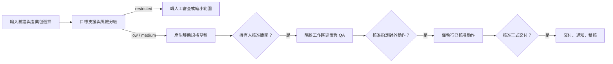

# 產業自動化包 / Industry Automation Packs

產業包是「可稽核的靜態工作流程合約」，用來界定支援目標、估計範圍、成效指標、核准要求、禁止動作與輸入範例。它們不是下載後即可執行任意程式的外掛，也不是對營收、回收期、節省工時或商業成功的保證。

系統只允許從程式碼內的版本化 registry 選擇產業包。設計上不會從公開表單、遠端 URL 或顧客文字載入可執行指令。

## 內建的六種靜態產業包

| ID | 適用的重複作業 | 支援目標 | 基礎風險 | 自動化覆蓋率估計 |
|---|---|---|---:|---:|
| `commerce_ops` | 訂單、庫存摘要、履約狀態與客服分類 | 報表、名單跟進、文件作業、營運警示 | 低 | 35–60% |
| `professional_services` | 諮詢分流、專案狀態、工時與交付草稿 | 報表、名單跟進、文件作業 | 中 | 25–50% |
| `appointments` | 可用時段、預約請求、狀態與已核准 FAQ | 報表、名單跟進、排程、營運警示 | 中 | 30–55% |
| `creator_education` | 自有文稿、課程素材、內容日曆與聚合效果 | 報表、名單跟進、內容作業、文件作業 | 低 | 35–65% |
| `property_field` | 服務請求、物件摘要、可用時段與檢查表 | 報表、名單跟進、排程、文件作業、營運警示 | 中 | 25–50% |
| `backoffice` | 已核准試算表、共用信箱 metadata、CRM 狀態與文件索引 | 報表、名單跟進、文件作業、營運警示 | 低 | 30–60% |

覆蓋率是在輸入品質、工作量與核准範圍尚未經實測時的初步區間。實際數字必須用組織本身的基準期與試運轉資料重新驗證，不得改寫成保證。

## 合約欄位

每個產業包必須完整定義：

- `id`：穩定、不隨顯示語言改變的 ID。
- `version`：合約版本；可影響舊案件的變更應新增版本，不可靜默改變意義。
- `riskTier`：基礎風險為 `low` 或 `medium`；實際提案仍可被升級為 `restricted`。
- `coverage.low` / `coverage.high`：介於 0 與 1 之間的估計範圍，且 low 不得大於 high。
- `goals`：限於 `reporting`、`lead_followup`、`scheduling`、`content_ops`、`document_ops`、`operations_alerts`。
- `metrics`：驗證前後差異的可觀測指標；每包都必須包含 `manual_interventions`。
- `requiredApprovals`：資料存取、訊息、排程、發佈、交付或對外動作前的核准節點。
- `prohibitedActions`：無法以一般核准繞過的用途。
- `inputExamples`：可接受的低敏感摘要、metadata、已核准範本或聚合資料範例。

## 風險分級

| 等級 | 含意 | 處理方式 |
|---|---|---|
| `low` | 以讀取、摘要、草擬或可逆作業為主 | 仍需範圍核准與正式交付核准 |
| `medium` | 涉及客戶承諾、排程、機密文件、多平台或較高誤擊成本 | 加上精確動作核准、資料最小化與人工抽查 |
| `restricted` | 要求任意未審閱對外寫入，或涉及受監管、重大權益與不可逆決策 | 不建立自動化交付工作；轉人工審查或縮小為安全的讀取／草擬範圍 |

目前規則會將受監管產業，以及 `autonomous_external_action` 或舊有 `write_back` 範圍標記為 `restricted`；`multi_platform` 至少為 `medium`。基礎等級不能降低其他規則所得的風險。

## 核准閘門

正常縱向流程保留以下閘門：

通過範圍核准不等於核准所有對外動作。例如預約訊息、內容發佈、資料寫入或生產部署，都必須符合產業包的 `requiredApprovals` 並留下實際 approval record。

## 禁止用途

以下事項不是本專案的全自動成功路徑：

- 自動退款、改變支付、銀行轉帳、薪資變更、折扣或刪除資料。
- 法律、金融或醫療建議，醫療分流與緊急事件導向。
- 客戶資格、住房資格、房客評分、聘僱、安全認證或其他重大權益決策。
- 未審閱的訂單、預約、合約、客戶承諾、公開發佈或對外訊息。
- 抄襲、虛構聲明，或將顧客個資、機密資料、敏感備註交給 AI。
- 把公開表單的文字當作系統指令，或從未審閱的遠端資源下載並執行程式碼。

## 新增或修改產業包

1. 先提出問題與實際工作流，確認它能由結構化資料、已核准範本、草擬或可逆動作解決。
2. 在 `src/lib/industry-packs.ts` 新增穩定 ID 與完整合約，不要動態匯入第三方程式碼。
3. 對照禁止用途、資料流向與最小權限，標註基礎風險、動作層核准與人工接管路徑。
4. 在英文、繁體中文、日文、西班牙文字典加入相同 key，並使不明或舊有 ID 回退至英文的安全預設。
5. 增加 registry 完整性、支援目標、風險升級、估算邊界、規格產生、舊案件相容與主要瀏覽器流程測試。
6. 更新本文件、批准矩陣與相關系統架構，執行 `pnpm verify` 與 `pnpm test:e2e`。

供應商特定的金流、郵件、CRM、行事曆、電商或 AI 串接只能是選配 adapter。沒有憑證時，內建 mock 路徑仍必須完成全部縱向流程，以保留自架與供應商中立性。
