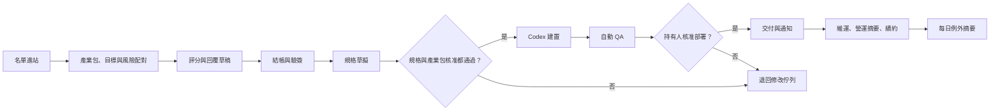

# 早安店長 Autopilot HQ：完整組織圖與組織樹

這是一間「一人持有、AI 執行可審閱作業」的多產業微型服務公司。AI 角色代表自動化工作流，不是法律上的員工、會計師或公司代表；對外付款、退款、合約、正式部署與個資權限仍由持有人核准。六種產業包是靜態服務藍圖，不代表所有產業都適用，也不保證獲利或節省固定工時。

## 組織圖

```mermaid
flowchart TB
    Owner["持有人／最終核准人\n策略、實名、帳戶與風險"]
    HQ["AI 營運總部\n排程、狀態機、稽核紀錄"]

    Owner -->|"設定目標與核准高風險動作"| HQ
    HQ --> Portfolio["產業藍圖部\n產業包、目標、風險、指標"]
    HQ --> Growth["成長部\n內容、名單、評分、跟進草稿"]
    HQ --> Revenue["營收部\n報價、結帳、對帳、續約"]
    HQ --> Delivery["交付部\n需求、規格、開發、QA、上線包"]
    HQ --> Success["客戶成功部\n導入、客服分流、營運摘要、留存"]
    HQ --> Ops["營運與風控部\n監控、備份、資安、稽核"]

    Portfolio --> Registry["Industry Pack Registry Agent"]
    Portfolio --> RiskReview["Risk & Prohibited-use Agent"]
    Portfolio --> Measure["Coverage & Metrics Agent"]

    Growth --> Intake["Lead Intake Agent"]
    Growth --> Scoring["Lead Scoring Agent"]
    Growth --> Sales["Sales Follow-up Agent"]

    Revenue --> Checkout["Checkout Agent"]
    Revenue --> Reconcile["Payment Reconciliation Agent"]
    Revenue --> Renewal["Renewal Agent"]

    Delivery --> Analyst["Requirements Analyst"]
    Delivery --> Builder["Codex Builder"]
    Delivery --> QA["QA Agent"]
    Delivery --> Release["Release Packager"]

    Success --> Onboard["Onboarding Agent"]
    Success --> Support["Support Triage Agent"]
    Success --> Report["Morning Report Agent"]

    Ops --> Queue["Queue Supervisor"]
    Ops --> Monitor["Health Monitor"]
    Ops --> Backup["Backup & Restore Agent"]
    Ops --> Security["Security & Secret Scan Agent"]
    Ops --> Audit["Audit Log Agent"]

    Analyst -.->|"規格核准"| Owner
    RiskReview -.->|"受限範圍／產業禁止用途"| Owner
    Reconcile -.->|"退款／金流異常"| Owner
    Release -.->|"正式部署核准"| Owner
    Security -.->|"高風險事件"| Owner
```



## 完整組織樹

```text
持有人／最終核准人（你）
├─ 只需負責
│  ├─ 實名註冊、銀行、稅籍、網域與第三方帳戶
│  ├─ 每週查看營運摘要與例外事項
│  └─ 核准規格、退款、正式部署與高風險權限
└─ AI 營運總部（Autopilot HQ）
   ├─ 01 產業藍圖部
   │  ├─ 產業包 registry：只管理六種版本化靜態藍圖
   │  ├─ 目標配對：檢查報表、跟進、排程、內容、文件與警示是否受支援
   │  ├─ 風險分級：低、中或受限，不允許產業禁止用途進入自動交付
   │  ├─ 成效估算：用上下界呈現工時、價值與回收期，不保證收益
   │  └─ 藍圖審查：檢查指標、核准、禁止動作、安全輸入與四語完整性
   ├─ 02 成長部
   │  ├─ 市場情報：追蹤多產業小型團隊的重複營運問題
   │  ├─ 內容生產：產生案例、FAQ、著陸頁與貼文草稿
   │  ├─ 名單接收：收集表單並驗證欄位與同意狀態
   │  ├─ 商機評分：依工作量、工時、團隊規模、痛點與目標評分
   │  └─ 銷售跟進：產生個人化回覆與預約／結帳引導
   ├─ 03 營收部
   │  ├─ 報價：由部署者設定固定幣別與價格，降低客製報價成本
   │  ├─ 結帳：交由正式金流頁處理卡號與身分資訊
   │  ├─ 對帳：驗證簽章、去重、記帳並啟動專案
   │  ├─ 續約：第二個月起使用部署者設定的幣別與月費
   │  └─ 例外：退款、爭議款、幣別或金額不符交給你核准
   ├─ 04 交付部
   │  ├─ 需求分析：把健檢資料轉為範圍、驗收與風險
   │  ├─ 規格草擬：自動產生可核准的工作規格
   │  ├─ Codex 建置：僅在規格核准後於隔離目錄執行
   │  ├─ QA：自動測試、品質檢查與結果留存
   │  └─ 發布包裝：你核准後才標記交付，不直接碰正式環境
   ├─ 05 客戶成功部
   │  ├─ 導入：寄送資料準備清單與最小權限說明
   │  ├─ 營運摘要：依已核准產業包彙整狀態、逾時、異常與人工介入次數
   │  ├─ 客服分流：FAQ 自答，資料錯誤與客訴轉人工
   │  ├─ 變更管理：小調整排入工作佇列並留下紀錄
   │  └─ 留存續約：到期提醒、健康摘要與停止服務流程
   └─ 06 營運與風控部
      ├─ 佇列主管：租約鎖、重試、退避與 dead-letter
      ├─ 健康監控：檢查網站、工作者、資料庫與失敗任務
      ├─ 備份還原：每日備份並定期執行完整性檢查
      ├─ 資安：秘密掃描、最小權限、個資遮罩與輸入驗證
      ├─ 稽核：記錄付款、核准、狀態改變與通知結果
      └─ 每日摘要：只把需要你決策的例外送到管理後台
```

## 決策權限

| 動作 | AI 可自動執行 | 需要持有人核准 |
|---|---:|---:|
| 接收表單、評分、草擬回覆 | 是 | 否 |
| 產業包選擇、目標配對、風險分級與範圍估算 | 是 | 否 |
| 受限範圍或產業禁止用途 | 否 | 不可以核准繞過；必須縮小範圍 |
| 驗證付款 Webhook、對帳、建立專案 | 是 | 否 |
| 草擬規格 | 是 | 否 |
| 啟動 Codex 建置 | 僅在規格已核准後 | 是 |
| 自動測試、備份、失敗重試、摘要 | 是 | 否 |
| 寄送一般交易通知 | 設定正式寄件網域後 | 否 |
| 公開部署、退款、合約、提高資料權限 | 否 | 是 |
| 稅籍、銀行、金流 KYC、發票責任 | 否 | 是 |

## 每日自動運轉節奏



目標不是零管理，而是把持有人工作縮到「提供實名憑證、每週看摘要、核准少數高風險動作」，其餘重複工作由系統排程與稽核。
