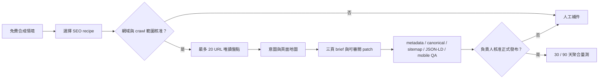

# SEO 主力服務：基礎改善衝刺

Morning Operator 把 SEO 定義為固定範圍、可量測、需人工核准的網站改善工作，不是大量產文工具，也不保證排名、索引、流量、商機或收益。

公開的 [SEO 成長實驗室](https://mars-tw.github.io/morning-operator/#seo-growth-lab) 只使用分類按鈕產生合成路線。它不要求網址、Email、分析帳號或客戶紀錄，不會抓取網站、保存資料、提交 sitemap、要求索引或修改正式環境。

## 固定範圍

一個 `professional-seo-foundation@1` 專案包含：

- 一個已證明擁有權或獲授權的 canonical origin。
- 一種語言與市場。
- 最多 20 個已核准公開 URL。
- 三個優先改善頁面。
- 一個 repository 或 CMS 來源。
- 一種目標受眾與一項主要服務。
- 一次人工審閱修正。
- 一份 90 天量測與例外佇列模板。

第二個網域、語言、下一批 20 URL 或額外修正必須建立另一個經核准範圍。這能避免爬取、內容與承諾無限制擴張。

## 執行工作流

付款成功只能建立專案，不能取代網域所有權、crawl 範圍、Search Console 唯讀存取、內容主張、結構化資料及正式發布核准。

## 交付物

- 搜尋意圖與最多 20 URL 的頁面對應表。
- crawl、index、robots、noindex、canonical、hreflang、sitemap、title、description、H1、內部連結及圖片替代文字檢查。
- 三個優先頁面的內容改善 brief 與可審閱 source patch。
- 只描述頁面可見事實的 JSON-LD 草稿；不製造評分、評論、價格或成果。
- build、連結、結構化資料與手機版 QA 證據。
- 30／90 天聚合成效模板及人工例外佇列。

## 衡量方式

交付品質使用以下指標：

- 範圍內 URL 完成檢查的比例。
- 優先頁面是否取得人工核准。
- 新增的錯誤 noindex、canonical、broken link 或無效 JSON-LD 數量。
- typecheck、測試、建置及秘密掃描結果。
- 建議採用率、技術問題重複率及人工介入次數。

90 天結果觀測使用聚合的 impressions、qualified organic clicks、indexed priority pages 及 owner-defined conversion events。Average position 只能當輔助趨勢；所有變化都不等於因果或收益保證。

## 可自動化與人工閘門

取得明確核准後，可以自動執行限定 URL 盤點、缺漏比對、metadata／sitemap／robots／JSON-LD 草稿、隔離 workspace patch、測試及聚合報表。

必須人工核准：

- `domain_ownership`
- `crawl_scope`
- `priority_pages`
- `search_strategy`
- `claim_and_content_accuracy`
- `structured_data_accuracy`
- `search_console_access`
- `production_publication`

不得自動執行：

- 未授權 crawl、繞過登入或存取控制。
- Keyword stuffing、hidden text、cloaking 或 doorway pages。
- 購買外鏈、自動寄外鏈信、垃圾留言或 link scheme。
- 大量相似 AI 頁面、抄襲、假更新日期或假專業資格。
- 假評論、假評分、假在地商家、假案例或誤導 JSON-LD。
- 自動發布、提交索引、修改 DNS、Search Console、analytics 或正式 CMS。
- 把帳密、原始訪客事件、Search Console 完整匯出或個資傳給 AI。

## 技術 SEO 基礎

Next.js 主站現在使用：

- 經驗證的 `AUTOPILOT_BASE_URL` 產生 absolute canonical 與 sitemap URL。
- 四個 locale URL 與 reciprocal language alternates，加上 `x-default`。
- `robots.ts` 排除 API；管理頁本身輸出 `noindex`，robots 不是安全控制。
- `sitemap.ts` 只列公開 locale，不列 root redirect、admin、API 或 checkout。
- Open Graph、Twitter image 及與頁面可見內容一致的 JSON-LD。

GitHub Pages 展示站位於 `/morning-operator/` 子路徑，因此該專案資料夾中的 `robots.txt` 不能控制 `mars-tw.github.io` 主機根層級。展示站會發布 absolute canonical、sitemap、社群 metadata、JSON-LD 與 404 `noindex`；若要完整控制 robots，應改用經核准的自訂網域或可控制主機根目錄的部署。

## 官方依據

- [Google SEO Starter Guide](https://developers.google.com/search/docs/fundamentals/seo-starter-guide)
- [Google Search crawling and indexing](https://developers.google.com/search/docs/crawling-indexing)
- [Google sitemap guidance](https://developers.google.com/search/docs/crawling-indexing/sitemaps/build-sitemap)
- [Google localized versions](https://developers.google.com/search/docs/specialty/international/localized-versions)
- [Google structured data guidelines](https://developers.google.com/search/docs/appearance/structured-data/sd-policies)
- [Google spam policies](https://developers.google.com/search/docs/essentials/spam-policies)
- [Next.js metadata and Open Graph images](https://nextjs.org/docs/app/getting-started/metadata-and-og-images)
- [Next.js sitemap convention](https://nextjs.org/docs/app/api-reference/file-conventions/metadata/sitemap)

Sitemap 只是搜尋引擎發現 URL 的提示；正確結構化資料也不保證 rich result。SEO 改善應以對人有用的原創內容、可驗證技術品質與持續量測為中心。
