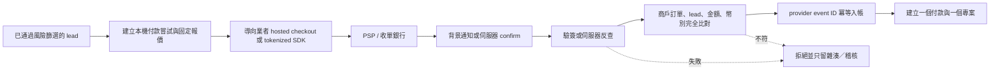

# 台灣與開源金流接入

最後查核：2026-07-17。金流 API、費率、審核條件及可用付款方式會變動，上線前必須再核對業者官方文件與商家後台。

## 先講結論

開源支付軟體是「結帳、路由、帳單、對帳或 provider adapter」，不是銀行收單資格。自架 Hyperswitch、Kill Bill 或 Medusa 仍然需要與綠界、藍新、TapPay、LINE Pay、銀行或其他 PSP 簽約，完成 KYC 並支付業者費用。任何方案都不能合法跳過商家審核、稅務、退款與爭議款責任。

目前預設建議是：台灣第一條正式路徑使用已實作的綠界 AIO；需要特定收單銀行、卡片 token 化或電子錢包時再評估 TapPay；需要藍新的付款方式與既有商家合約時新增 NewebPay adapter；LINE Pay 直連只在已取得 LINE Pay 商家資格且願意維護 reserve/confirm 狀態機時使用。

## 接入狀態矩陣

| 方案 | 適用情境 | 專案狀態 | 付款成立的唯一依據 |
|---|---|---|---|
| 綠界 ECPay AIO | 台灣固定價服務、信用卡／ATM／超商等 hosted checkout | 已實作結帳、付款嘗試、驗簽與冪等入帳 | 背景 ReturnURL 的完整 CheckMacValue、MerchantID、RtnCode、商戶訂單、lead、金額與 TWD 全部相符 |
| 藍新 NewebPay MPG | 已有藍新合約或需要藍新付款方式 | 接入藍圖，尚未宣稱可收款 | TradeSha、TradeInfo 解密結果、商戶訂單映射及伺服器交易查詢相符 |
| TapPay | 需要前端 token 化、3D Secure、特定收單銀行或電子錢包 | 接入藍圖，尚未宣稱可收款 | Pay by Prime／Record API 的伺服器結果；前端 redirect 永遠不是證明 |
| LINE Pay Taiwan 直連 | 已核准的 LINE Pay 商家、願意維護兩階段交易 | 接入藍圖，尚未宣稱可收款 | reserve 後由伺服器 confirm，`returnCode=0000` 且訂單、金額、幣別相符 |
| Lemon Squeezy | 合法可服務的海外市場與數位商品／服務 | 已實作 webhook | 原始 body HMAC 與固定報價相符 |

管理員可在 `/admin` 的「金流接入狀態」查看哪些 adapter 已實作、哪些只完成文件，以及必要環境設定是否齊全；畫面只顯示布林狀態，不回傳秘密值。

## 統一安全流程



所有 provider 都必須遵守相同邊界：不在本系統收集卡號或 CVV、不相信瀏覽器跳轉、不接受低於固定報價的簽章事件、不由 AI 自動退款、不把 raw webhook 或秘密寫入 log、重送不能建立第二個專案。

## 綠界 ECPay AIO：已實作

官方 AIO 以 `application/x-www-form-urlencoded` POST 導向測試或正式付款頁。系統端點如下：

```text
GET  /api/payments/ecpay/checkout?leadId=<uuid>
POST /api/webhooks/payments/ecpay
```

結帳端點只接受狀態為 `qualified` 的 lead，從伺服器固定報價建立唯一的 `MerchantTradeNo`，將 lead UUID 放進 `CustomField1`，計算 SHA-256 `CheckMacValue` 後自動 POST 到綠界。回呼會重新計算所有欄位的 CheckMacValue，拒絕重複欄位造成的簽章歧義，並要求回呼內容對到本機 `payment_attempts`。

```dotenv
AUTOPILOT_BASE_URL=https://operator.example.com
NEXT_PUBLIC_OFFER_CURRENCY=TWD
NEXT_PUBLIC_OFFER_SETUP_MINOR=19800
NEXT_PUBLIC_CHECKOUT_URL=/api/payments/ecpay/checkout?leadId={leadId}
ECPAY_ENVIRONMENT=stage
ECPAY_MERCHANT_ID=<secret-store>
ECPAY_HASH_KEY=<secret-store>
ECPAY_HASH_IV=<secret-store>
```

不要把上述實際值提交到 Git。正式環境必須使用 HTTPS；`ECPAY_ENVIRONMENT=production` 會拒絕 `SimulatePaid=1` 作為付款。官方規格：[AIO 建立訂單與 ReturnURL](https://developers.ecpay.com.tw/2864/)、[CheckMacValue 計算](https://developers.ecpay.com.tw/2902/)。

## 藍新 NewebPay MPG：接入藍圖

1. 建立本機 `payment_attempts`，用藍新 `MerchantOrderNo` 對應 lead，不把 email 或個資塞進訂單編號。
2. 依官方手冊把訂單參數加密成 `TradeInfo` 並產生 `TradeSha`，瀏覽器 POST 到 MPG 測試／正式端點。
3. ReturnURL／NotifyURL 收到資料後先驗證 TradeSha，再解密 TradeInfo；只接受成功狀態。
4. 以藍新交易查詢 API 反查，確認 MerchantID、MerchantOrderNo、TradeNo、Amt 與本機固定報價。
5. 以 TradeNo 作 provider event ID 冪等入帳。取消授權、請退款與電子錢包退款維持負責人批准，不接在自動工作佇列。

專案目前不提供 NewebPay webhook 路由，因為未取得商家測試憑證與可驗證的本機訂單 mapping 前，僅憑社群 AES 範例建立「看似可用」的 adapter 風險太高。官方入口：[藍新 API 文件下載](https://cwww.newebpay.com/website/Page/content/download_api)。

## TapPay：接入藍圖

1. 前端只使用 TapPay SDK 取得一次性的 prime；本系統不接收或保存卡號、到期日及 CVV。
2. 伺服器以 partner key／merchant ID 呼叫 Pay by Prime；3D Secure 或電子支付必須設定 HTTPS `backend_notify_url`。
3. 後端通知只作為喚醒訊號，再以 `rec_trade_id` 呼叫 Record API 核對最新狀態、order number、金額與幣別。
4. `status=0` 且本機付款嘗試完全相符才入帳。前端 redirect 可偽造，不能建立付款。
5. TapPay 會對未回 HTTP 200 的 backend notify 進行有限次重送，因此處理必須冪等且快速回應。

官方文件：[TapPay Backend / Pay by Prime / Backend Notify](https://docs.tappaysdk.com/tutorial/en/back.html)。

## LINE Pay Taiwan 直連：接入藍圖

1. 本機先建立唯一 order ID 與固定金額，再由伺服器呼叫 payment reserve API。
2. 將使用者導向回傳的 LINE Pay payment URL；保存 `transactionId`，不要把它視為已付款。
3. 使用者回到 `confirmUrl` 後，由伺服器用相同金額與幣別呼叫 confirm API。
4. 只有 confirm 回應 `returnCode=0000` 且 order ID、transactionId、金額及幣別對到本機付款嘗試時才入帳。
5. timeout 或不確定結果必須查詢交易狀態，不能盲目重複扣款。退款仍需負責人批准。

官方文件：[LINE Pay Taiwan merchant integration guide](https://pay.line.me/file/guidebook/technicallinking/LINE_Pay_Integration_Guide_for_Merchant-v1.1.0-TW.pdf)。

## 開源方案怎麼用

| 開源專案 | 能解決什麼 | 不會替你解決什麼 | 對本專案的建議 |
|---|---|---|---|
| [Hyperswitch](https://github.com/juspay/hyperswitch) | 多 PSP connector、路由、重試、vault、觀測與對帳 | 台灣 PSP 商家合約與未現成支援的 connector | 交易量與 provider 數量上升後再獨立部署；先確認台灣 provider connector，沒有就依官方 connector guide 開發與測試 |
| [Kill Bill](https://docs.killbill.io/latest/) | 訂閱、帳單、催收、付款 plugin 與稽核 | hosted checkout 與台灣收單資格 | 只有在月費、用量計費或複雜訂閱成為核心需求時採用；目前固定服務不要增加此運維負擔 |
| [Medusa Payment Module](https://docs.medusajs.com/resources/commerce-modules/payment/payment-provider) | 電商的付款 session、authorize/capture/refund provider abstraction | 不是 PSP，也不是 Morning Operator 現有架構的必要元件 | 客戶本身以 Medusa 建商城時寫 adapter；不要為了單一固定價服務重做整個商務核心 |
| [ECPay API Skill](https://github.com/ECPay/ECPay-API-Skill) | 綠界官方維護的 API 知識、測試向量與整合指南 | 商家憑證、KYC 或正式交易批准 | 可作開發期交叉驗證；固定版本，任何產出仍須通過本專案測試與安全閘門 |

本機已透過 Codex skill installer 安裝固定的 ECPay skill 版本；它只在後續任務載入，不會被打包進應用程式，也不會取得環境秘密。

## 正式切換檢查表

- 商家 KYC、銀行帳戶、服務條款、隱私、退款與爭議款流程已完成。
- 正式報價、幣別、稅與發票責任已由負責人確認。
- 密鑰由 secret manager 注入，沒有出現在 Git、image、log、截圖或聊天。
- 測試過有效付款、錯簽章、錯商戶、低付、錯幣、重送、逾時與 provider 後台反查。
- 資料庫備份與 restore-check 已通過；付款事件、付款嘗試與專案可對帳。
- mock route 在正式環境不可用，`SimulatePaid` 不會成為正式付款。
- 退款、折扣、商家設定變更與正式部署仍有負責人批准紀錄。
